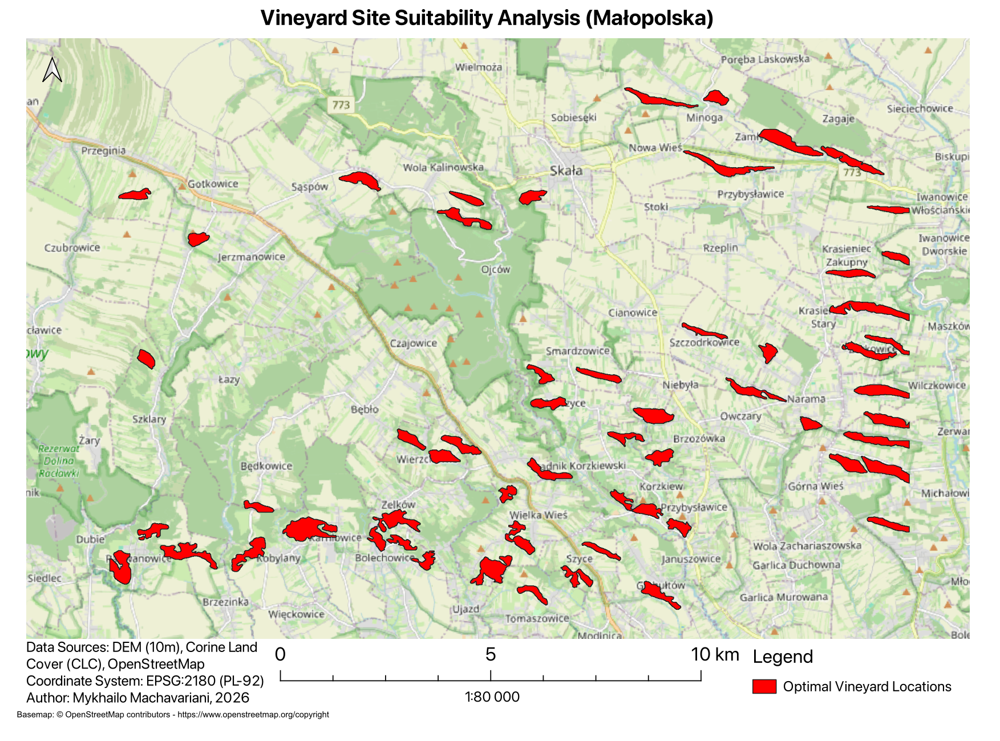

# Potential vineyard areas in Malopolska

## About the project

I used QGIS to look for potential vineyard areas. From a terrain model, I calculated slope and aspect, then combined these with land-cover and protected-area conditions. I filtered the result, removed small areas, and calculated statistics for the remaining candidate areas.

## Main steps

1. Work with the supplied 10 m terrain, CLC and protected-area rasters in EPSG:2180.
2. Select slopes of 5-20 degrees and south-facing terrain (135-225 degrees).
3. Combine these with the allowed land-cover classes and protected-area mask using Boolean operations.
4. Apply a 7 x 7 modal filter and remove small areas using a 10 ha threshold.
5. Group the remaining areas and compare their terrain statistics.

The saved result contains 57 groups, covering about 1,014 ha in total.

## Open it

1. [Download the complete project ZIP](https://github.com/limerun/malopolska-vineyard-suitability/releases/download/v1.0/malopolska-vineyard-suitability-full-project.zip).
2. Extract the archive and open `project.qgz` in QGIS. Keep the `data` folder next to it.
3. Internet is needed for the OpenStreetMap background. Tested with QGIS 3.42.1.

The repository contains the map, project file and documentation. The ZIP in Releases also includes all required data files. See [data sources](DATA_SOURCES.md).
